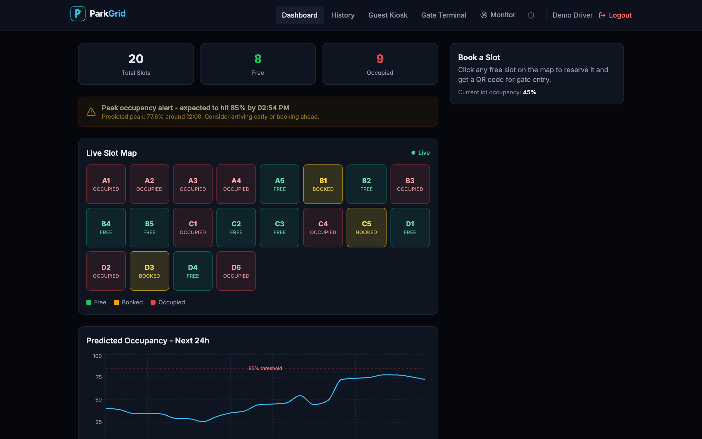
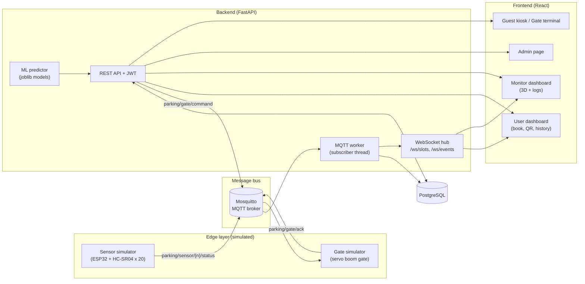
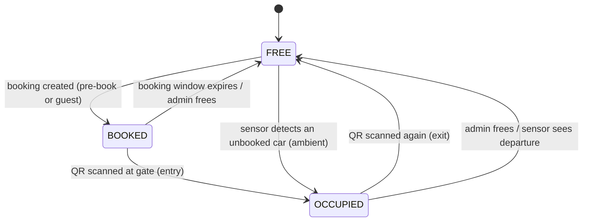
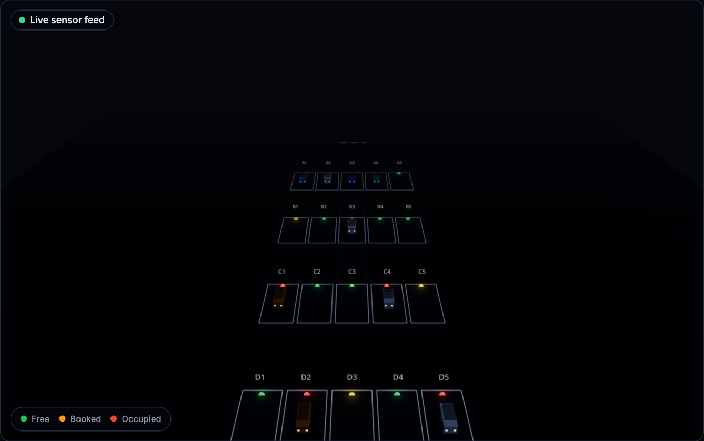
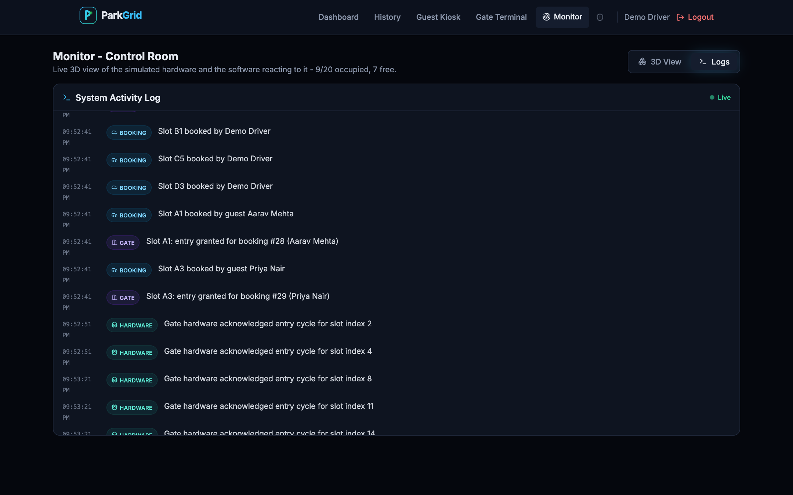
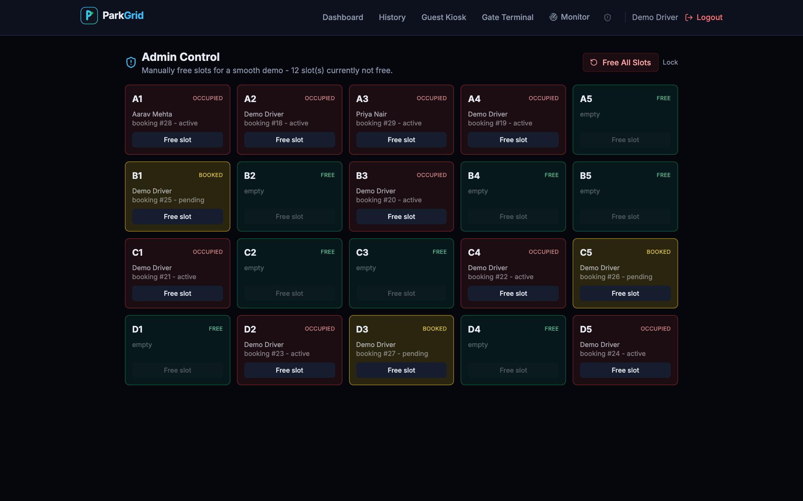
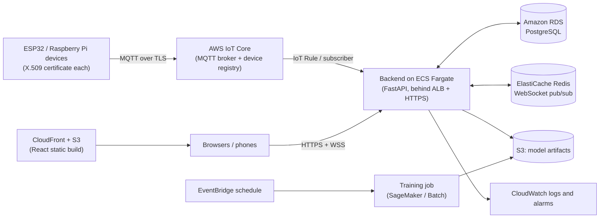
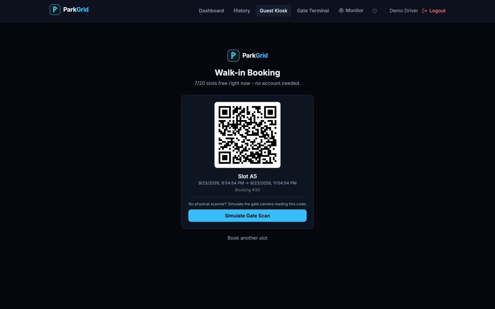
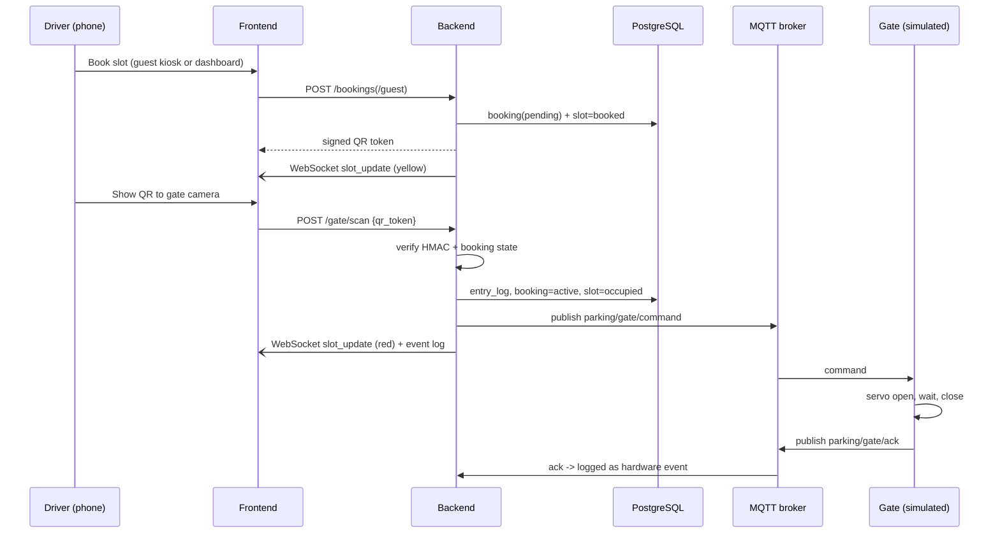
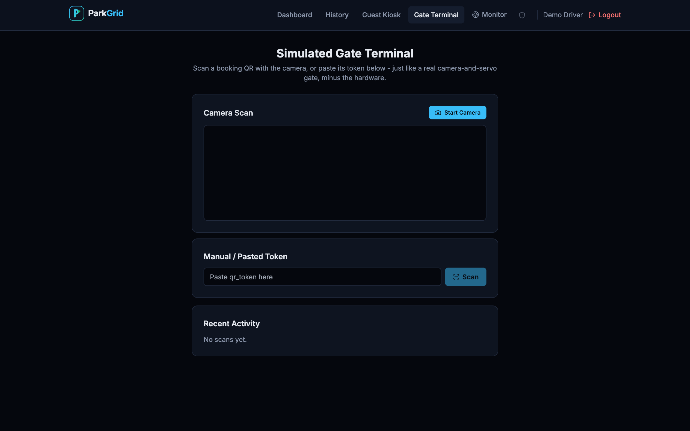

# ParkGrid - Smart Parking Allocation System

**An IoT / Internet-of-Everything project: automated parking allocation with pre-booking, walk-in booking, QR-based gate entry/exit, real-time slot monitoring and ML-driven peak-occupancy alerts.**

> Scope note: no physical hardware was built. The sensors and the gate are **simulated in software** and talk to the rest of the system over MQTT exactly as real devices would. The backend, database, ML pipeline, QR system and both dashboards are real, working software. Section 4 lists the hardware that would be used in an actual deployment, and Section 9 describes the cloud deployment design (designed, not deployed).

---

## Table of contents

1. [Project overview](#1-project-overview)
2. [System architecture](#2-system-architecture)
3. [Technology stack at a glance](#3-technology-stack-at-a-glance)
4. [IoT layer: how it is simulated, and what real hardware would be used](#4-iot-layer)
5. [Machine-learning pipeline](#5-machine-learning-pipeline)
6. [Backend](#6-backend)
7. [Frontend](#7-frontend)
8. [QR code system](#8-qr-code-system)
9. [Cloud implementation (proposed deployment)](#9-cloud-implementation-proposed-deployment)
10. [Working of the project](#10-working-of-the-project)
11. [End-to-end data pipeline](#11-end-to-end-data-pipeline)
12. [Results](#12-results)
13. [Challenges faced and bugs found](#13-challenges-faced-and-bugs-found)
14. [Limitations and future work](#14-limitations-and-future-work)
15. [Running the project and repository layout](#15-running-the-project-and-repository-layout)

---

## 1. Project overview

### 1.1 Problem
Finding a parking space wastes time and fuel, causes congestion at entrances, and needs an attendant to check tickets and lift barriers. Drivers also get no warning that a lot is about to fill up.

### 1.2 Solution
ParkGrid is a parking lot with **indexed slots** (20 slots, labelled A1 to D5). Each slot has a sensor and an LED indicator. Users can:

1. **Pre-book** a specific slot from the web dashboard and receive a unique, signed **QR code**.
2. **Walk in without a booking** and book as a guest at a gate-side kiosk; the system auto-assigns the nearest free slot.
3. **Enter and exit by scanning the QR** at a camera-equipped gate. The gate opens automatically, with no attendant.
4. See **ML-driven alerts** predicting when the lot will cross its peak-occupancy threshold, so they can avoid congestion.

A second **Monitor (control-room) dashboard** shows the whole system live in 3D, with a human-readable activity log, for demonstration and for a security desk. An **Admin** page lets the operator reset slots.

### 1.3 Objectives
- Show a complete IoT data path: sensor -> message bus -> backend -> database -> live UI.
- Keep the backend agnostic to whether data comes from simulated or real sensors.
- Make gate access contactless and tamper-proof (signed QR tokens).
- Predict lot congestion with a model that is evaluated honestly (chronological split, baseline comparison).

### 1.4 Key features

| Area | Feature |
|---|---|
| Booking | Pre-book a chosen slot for a time window; guest walk-in booking with no account |
| Access control | HMAC-signed QR; same QR toggles entry then exit; expired/duplicate/forged codes rejected |
| Live status | Slot map updated over WebSocket; green = free, yellow = booked, red = occupied |
| ML | Occupancy forecast for the next 24 h and a "will cross 85%" alert banner |
| Monitor dashboard | Live 3D lot with LEDs and parked cars, animated gate and car, webcam QR scanning, live activity log |
| Admin | Free one slot or all slots for demo resets (token protected) |
| Ops | Every booking, gate action, sensor change and hardware acknowledgement is logged as a readable event |
| UX | Dark theme, custom logo/favicon, no emoji, usable from a phone on the same network |



---

## 2. System architecture



**Plain-text version of the same picture**

```
 [ESP32 + HC-SR04 x20]          [Servo gate]
        |  publish                 ^   |
        v                          |   | ack
   +--------------------------- MQTT broker (Mosquitto) ---------------------+
        |  sensor events                ^  gate "open" commands               
        v                               |                                     
   +----------------------  FastAPI backend  ---------------------------+     
   | MQTT worker -> PostgreSQL <- REST API (bookings, gate, admin, ML)   |     
   |        \-> WebSocket hub (slot updates + event log)                 |     
   +---------------------------------------------------------------------+     
        |  REST + WebSocket                                                    
        v                                                                       
   [ React app:  User dashboard | Monitor (3D + logs) | Admin | Kiosk | Gate ] 
```

### Design decisions worth explaining
- **MQTT decouples hardware from software.** The backend only consumes `parking/sensor/+/status` and `parking/gate/ack`. It cannot tell a simulator from a real ESP32 sending the same JSON, so swapping in real hardware needs no backend change.
- **PostgreSQL is the source of truth**; WebSocket messages are only a push notification of the latest state.
- **The gate is a separate actor.** The backend publishes an "open" command; the gate acknowledges when its servo cycle finishes. The acknowledgement is logged as a separate hardware event.

---

## 3. Technology stack at a glance

| Layer | Technology |
|---|---|
| Edge simulation | Python 3, `paho-mqtt` |
| Message bus | Eclipse Mosquitto 2 (MQTT 3.1.1/5) |
| Backend | Python, FastAPI, Uvicorn, SQLAlchemy 2, Alembic, Pydantic v2 |
| Auth and security | JWT (`python-jose`), bcrypt (`passlib`), HMAC signed QR (`itsdangerous`), admin shared token |
| Database | PostgreSQL 16 |
| Real-time | WebSockets (FastAPI/Starlette) |
| ML | scikit-learn (RandomForest), pandas, NumPy, joblib; UCI "Parking Birmingham" dataset |
| Frontend | React 18, Vite 5, Tailwind CSS 3, React Router 6, Axios, Recharts |
| 3D | Three.js, `@react-three/fiber`, `@react-three/drei` |
| QR | `qrcode.react` (generate), `html5-qrcode` (camera decode) |
| Packaging | Docker and Docker Compose (7 services) |

Approximate code size (excluding dependencies): backend 1,500 lines, frontend 2,400 lines, hardware simulation 320 lines, ML 390 lines.

---

## 4. IoT layer

### 4.1 How the hardware is simulated

There is no Wokwi project or physical device. Two Python programs behave like firmware and publish real MQTT messages, so everything downstream is genuine.

**Sensor simulator** (`hardware-sim/sensor_simulator.py`) imitates an ESP32 with one HC-SR04 ultrasonic sensor per slot.
- It runs a **simulated clock** (default 60x speed: one real minute is one simulated hour).
- The lot-wide occupancy target follows a **day curve** (about 3% at 3 AM, rising to about 92% at noon, falling in the evening), shaped after the Birmingham dataset, so peaks occur and there is something for the ML model to predict.
- Each tick, every slot randomly arrives or leaves with a probability that pulls occupancy towards the target for that hour.
- For each slot it emits a **raw distance** (3 to 28 cm if a car is present, 40 to 400 cm if not) and applies the same **30 cm threshold** real firmware would use to derive `occupied`.
- It publishes a **full state message for every slot every tick**, like a real sensor reporting continuously.
- It **listens to gate commands**: when a car is admitted through the gate, that slot is "held" occupied and excluded from random churn until the exit command. Without this, the random simulation immediately overwrote real gate scans (see Section 13).

**Gate simulator** (`hardware-sim/gate_simulator.py`) imitates an ESP32 driving a servo boom barrier.
- Subscribes to `parking/gate/command`.
- On a command it logs a servo sweep 0 to 90 degrees (open), holds for a few seconds, sweeps 90 to 0 (close) and publishes an **acknowledgement**.
- It writes its own local log lines, standing in for serial output / flash logging on the device.

The ambient sensor simulator is **opt-in** (Docker Compose profile `simulation`) so that a live demo only changes when the presenter acts.

### 4.2 MQTT topics and payloads

| Topic | Direction | Payload (JSON) |
|---|---|---|
| `parking/sensor/{slot_index}/status` | device -> backend | `{"sensor_id":"esp32-05","slot_index":5,"distance_cm":12.4,"occupied":true,"timestamp":"...","sim_time":"..."}` |
| `parking/gate/command` | backend -> gate | `{"action":"open","direction":"entry"\|"exit","booking_id":14,"slot_index":1,"timestamp":"..."}` |
| `parking/gate/ack` | gate -> backend | `{"booking_id":14,"slot_index":1,"direction":"entry","status":"completed","timestamp":"..."}` |

QoS 1 is used so messages are delivered at least once.

### 4.3 IoT components for a real implementation

The following is the bill of materials that would replace the simulators. Quantities are for the 20-slot lot.

| # | Component | Qty | Role in the system | Simulated here by |
|---|---|---|---|---|
| 1 | **ESP32 DevKit (Wi-Fi/BLE MCU)** | 5 (1 per 4 slots) + 1 at the gate | Reads sensors, drives LEDs, publishes MQTT over Wi-Fi | `sensor_simulator.py`, `gate_simulator.py` |
| 2 | **Arduino Uno / Nano** (alternative) | optional | Simple sensor-node option where Wi-Fi is provided by an ESP-01 or Ethernet shield | - |
| 3 | **Raspberry Pi 4 (4 GB)** | 1 | Edge gateway at the gate: runs Mosquitto, camera QR decoding, and can host the backend for an on-premise setup | Docker host on the laptop |
| 4 | **HC-SR04 ultrasonic sensor** (or waterproof JSN-SR04T) | 20 | Measures distance to the car roof/bumper; below about 30 cm means occupied | simulated distance + 30 cm threshold |
| 5 | **IR obstacle / proximity sensor** (e.g. E18-D80NK) | 2 | Detects a vehicle waiting at the gate lane and a vehicle leaving, so the boom does not close on a car | not simulated |
| 6 | **RGB LED (common cathode) or discrete red/green/yellow LEDs** | 20 | Per-slot indicator: green = free, red = occupied, red+green mix = yellow = booked | LED colour in the 3D view and slot grid |
| 7 | **220 ohm resistors** (one per LED colour channel) | 60 | Current limiting for the LEDs | - |
| 8 | **SG90 / MG996R servo motor** (12 V linear actuator or boom motor in production) | 1 | Raises and lowers the boom barrier | `gate_simulator.py` servo log |
| 9 | **Pi Camera Module v2 / USB webcam** (or ESP32-CAM) | 1-2 | Reads the driver's QR code at the entry and exit lane | Browser webcam via `html5-qrcode` |
| 10 | **SSD1306 OLED or 16x2 I2C LCD** | 1-2 | Shows "Welcome, go to A4" or an error at the gate | Success/error banner in the UI |
| 11 | **Active buzzer** | 1 | Audible feedback for accepted/rejected scan | - |
| 12 | **5 V relay module** | 1 | Switches the boom motor / barrier supply safely from the MCU | - |
| 13 | **5 V / 12 V power supply and buck converter** | 1 set | Powers sensors, MCUs and the barrier | - |
| 14 | **Logic-level shifter / resistor divider** | 20 | HC-SR04 echo is 5 V; ESP32 inputs are 3.3 V | - |
| 15 | **Wi-Fi access point / router** (LoRa gateway as an option for large lots) | 1 | Network backbone for all devices | Docker network |
| 16 | **Weatherproof enclosures, cabling, breadboards/PCBs** | - | Mechanical installation | - |

**Typical wiring (per slot node on an ESP32)**
- HC-SR04: `VCC` to 5 V, `GND` to GND, `TRIG` to a GPIO output, `ECHO` to a GPIO input through a resistor divider (5 V -> 3.3 V).
- LED: each colour channel through a 220 ohm resistor to a GPIO output (common cathode to GND).
- Firmware loop: trigger ultrasonic pulse, compute `distance_cm = echo_time * 0.0343 / 2`, compare with the 30 cm threshold (with a few-sample median filter to avoid flicker), set the LED, and publish JSON to `parking/sensor/{n}/status`.

**Gate node** (ESP32 or the Raspberry Pi): subscribes to `parking/gate/command`, energises the relay/servo, waits for the IR sensor to confirm the car has passed, closes the barrier and publishes the acknowledgement.

**Why these choices**
- ESP32: built-in Wi-Fi, low cost, MQTT libraries, enough GPIO for several slots.
- Ultrasonic rather than IR for slot occupancy: a car body at 30 cm is a clean, distance-based signal, less sensitive to colour and sunlight than an IR reflective sensor. IR is kept for the gate lane where a simple beam-break is enough.
- Raspberry Pi at the gate: needs a camera and enough CPU to decode QR codes locally, so the gate still works if the internet is down.

---

## 5. Machine-learning pipeline

### 5.1 What it predicts
Two related predictions about **lot-wide occupancy**:

1. **Regression:** the occupancy percentage (0 to 100%) at a given time.
2. **Classification:** *will the next reading be at or above the 85% threshold?* (a "peak" or congestion flag). This drives the alert banner.

The dashboard combines them into a **24-hour forecast curve** and a warning of the form "expected to hit 85% by 2:54 PM".

### 5.2 Dataset
**UCI "Parking Birmingham" (dataset id 482)**: occupancy records from car parks in Birmingham, UK.

| Property | Value |
|---|---|
| Columns | `SystemCodeNumber`, `Capacity`, `Occupancy`, `LastUpdated` |
| Rows | 35,717 raw readings |
| Car parks | 30 |
| Period | 4 Oct 2016 to 19 Dec 2016 |
| Sampling | about one reading every 30 minutes per car park |
| Missing values | none |

The training script first tries `ucimlrepo.fetch_ucirepo(id=482)`, as specified in the brief. That call is rejected for this dataset id ("not available for import"), so the script falls back to downloading the archive's CSV export directly and caches it locally.

### 5.3 Feature engineering

| Feature | Meaning | Why it matters |
|---|---|---|
| `hour` | Hour of day (0-23) | Commuter pattern: low at night, peak around midday |
| `day_of_week` | 0-6 | Weekday vs weekend behaviour |
| `is_weekend` | 0/1 | Cleaner weekend flag |
| `capacity_ratio` | Lot capacity / largest capacity in the dataset | Lets the model account for lot size |
| `rolling_avg_occupancy` | Mean of the previous 3 readings for the same car park, **shifted by one** so the current value is never included | Recent trend; avoids target leakage |

Targets: `occupancy_pct = Occupancy / Capacity x 100` and `will_cross_threshold = next reading >= 85%`. The last reading of each car park is dropped because it has no "next" value.

### 5.4 Training and evaluation method
- **Chronological split, not random.** Train: 4 Oct to 5 Dec (28,545 rows). Test: 5 Dec to 19 Dec (7,142 rows). This tests true forecasting on unseen future time and prevents leakage through neighbouring readings.
- **Models compared** (notebook `ml/notebooks/eda_and_model_comparison.ipynb`): Linear Regression (baseline) and Random Forest. A small LSTM is implemented in the notebook for comparison, but it needs TensorFlow, which was not installed in the environment used, so **the LSTM was not trained and no LSTM numbers are reported**.
- **Shipped models:** `RandomForestRegressor` (200 trees, depth 12, min leaf 3) and `RandomForestClassifier` (200 trees, depth 10, `class_weight="balanced"`, because only 12.9% of readings are peaks).
- Artifacts (`occupancy_regressor.joblib`, `threshold_classifier.joblib`, `feature_meta.json`) are trained automatically by a Docker service on first start and reused afterwards.

### 5.5 Results

**Regression (test set, held-out future period)**

| Model | RMSE (occupancy %) | MAE | R2 |
|---|---|---|---|
| Linear Regression (baseline) | 13.41 | 9.31 | 0.759 |
| **Random Forest (shipped)** | **6.23** | **3.71** | **0.948** |

Random Forest cuts the error by more than half compared with the linear baseline, capturing the non-linear hour-of-day x recent-trend interaction.

**Classification: "will the next reading cross 85%?"**

| Class | Precision | Recall | F1 | Support |
|---|---|---|---|---|
| Below threshold | 0.99 | 0.94 | 0.96 | 5,988 |
| Will cross 85% | 0.75 | **0.95** | 0.84 | 1,154 |

Accuracy 0.94 and ROC-AUC 0.987. Recall on the "peak" class is deliberately favoured: missing a real peak is worse than a false alarm.

**Feature importance (Random Forest regressor)**

| Feature | Importance |
|---|---|
| `rolling_avg_occupancy` | 0.787 |
| `hour` | 0.171 |
| `capacity_ratio` | 0.030 |
| `day_of_week` | 0.009 |
| `is_weekend` | 0.003 |

Honest reading: the model mainly learns "occupancy now is close to occupancy a moment ago, adjusted by the time of day". That is a strong and legitimate signal for short-term forecasting, but it also means the accuracy figures partly reflect persistence.

### 5.6 How the model is served
`GET /predictions/peak` builds a forecast **hour by hour**: it starts from the lot's live occupancy, and for each future hour feeds the previous three predictions back in as the rolling average. It returns the curve, the peak hour and value, and the first hour that crosses 85%. The dashboard polls it every minute.

### 5.7 Known limitation and the retraining script
Birmingham lots hold hundreds to thousands of cars; ParkGrid has 20 slots. The model learns the **shape** of a parking day (hour and trend), not our exact scale, and `capacity_ratio` only partly compensates. `ml/retrain.py` rebuilds an hourly occupancy series from our own `entry_logs` table and retrains on it (blending with Birmingham data until enough real history exists). It has been written but **not run against real accumulated data**.

---

## 6. Backend

### 6.1 Structure
FastAPI application with routers for auth, bookings, gate, slots, predictions, events, admin and WebSockets. Alembic manages the schema (two migrations). A startup script waits for the database, runs migrations, seeds the 20 slots and starts Uvicorn. The MQTT worker runs on its own thread inside the same process.

### 6.2 Data model

| Table | Key columns |
|---|---|
| `users` | id, email (unique), full_name, hashed_password, is_active |
| `slots` | id, index (1-20), label (A1-D5), location, status (`free`/`booked`/`occupied`), updated_at |
| `bookings` | id, user_id (null for guests), slot_id, start_time, end_time, `qr_token` (unique), is_guest, guest_name/phone, status (`pending`/`active`/`completed`/`cancelled`/`expired`) |
| `entry_logs` | id, booking_id, entry_time, exit_time |
| `system_events` | id, timestamp, category (`booking`/`gate`/`sensor`/`hardware`/`system`), message, meta (JSON) |

### 6.3 REST and WebSocket API

| Method | Path | Auth | Purpose |
|---|---|---|---|
| POST | `/auth/signup`, `/auth/login` | - | Create account / log in, returns JWT |
| GET | `/auth/me` | JWT | Current user |
| POST | `/bookings` | JWT | Book a specific free slot, returns QR token |
| POST | `/bookings/guest` | - | Walk-in booking, nearest free slot |
| GET | `/bookings/me` | JWT | Booking history |
| POST | `/gate/scan` | - | Validate QR; entry or exit; publish gate command |
| GET | `/slots`, `/slots/live` | - | Current slot map |
| GET | `/predictions/peak` | - | ML forecast |
| GET | `/events/recent` | - | Recent activity log |
| GET/POST | `/admin/slots`, `/admin/slots/{id}/free`, `/admin/slots/reset-all` | Admin token | Operator controls |
| WS | `/ws/slots`, `/ws/events` | - | Live slot updates and live event feed |

### 6.4 Slot state machine



### 6.5 Reconciling three sources of truth
A slot's status can be changed by the booking/QR flow, by sensor messages and by the admin. The MQTT worker applies fixed rules:

| Current | Sensor says | Result |
|---|---|---|
| FREE | occupied | OCCUPIED (a car arrived without booking) |
| BOOKED | occupied | OCCUPIED (reserved car arrived) |
| OCCUPIED | free | FREE and the open entry log is closed |
| FREE / BOOKED | free | no change (a booked slot is expected to look empty) |

### 6.6 Event log
Every meaningful action creates a `system_events` row and is pushed to `/ws/events`, for example "Slot A1 booked by guest Priya Nair", "Slot A1: entry granted for booking #29", "Gate hardware acknowledged entry cycle for slot index 1". Only transitions are logged, not raw telemetry, so the log stays readable.

### 6.7 Admin
Protected by a shared `X-Admin-Token` header (default `123456789`, changeable through the `ADMIN_TOKEN` environment variable). Freeing a slot also closes the related booking (completed with an exit time if the car was inside, cancelled if it never arrived) and records a `system` event. This is a single-operator demo control, not a multi-role admin system.

---

## 7. Frontend

Single React application with two dashboards and helper pages, dark themed.

| Page | Purpose |
|---|---|
| **Dashboard** (login required) | Live slot map, stats, ML alert banner, 24 h forecast chart, click a free slot to book and get a QR |
| **History** | The user's bookings and their status |
| **Guest Kiosk** | Walk-in booking without an account; shows the QR |
| **Gate Terminal** | Camera or pasted-token QR scanner acting as the gate reader |
| **Monitor** | Tab 1: live 3D lot. Tab 2: live activity log |
| **Admin** (`/admin/dashboard`) | Token-gated slot control |

**Monitor 3D view.** A Three.js scene builds the 20 slots from the same live WebSocket feed as the 2D map. Each slot has an LED (green/yellow/red) and a car model when occupied. The gate has an animated boom, and a camera prop pulses while a scan is running. Scanning a QR (webcam or pasted token) calls the real `/gate/scan`; on success the boom lifts and a car drives from the gate to its slot, then the LED changes. Timing lives in one hook; the 3D pieces just render the progress they are given.







**Network access.** The frontend derives the backend address from the host it was loaded from (not a hard-coded `localhost`), so opening `http://<laptop-ip>:5173` on a phone works with no configuration.

---

## 8. QR code system

**Generation.** When a booking is created, the backend signs a small payload with a secret key using `itsdangerous.URLSafeSerializer` (HMAC-SHA1 with a salt):

```
payload  = {"booking_id": 14, "slot_id": 1}
qr_token = base64url(payload) + "." + signature      e.g.  eyJib29raW5nX2lkIjoxNCwic2xvdF9pZCI6MX0.zK3...
```

The token is stored on the booking row and rendered as a QR image in the browser (`qrcode.react`), inside a white box so it stays scannable on the dark theme.

**Validation at the gate** (`POST /gate/scan`):
1. Verify the signature. A forged or edited token is rejected (HTTP 400).
2. Load the booking and require the stored token to match exactly.
3. Reject bookings already completed, cancelled or expired; mark a pending booking expired if its time window has passed.
4. `pending` + no open entry log -> **entry**: create an entry log, booking becomes `active`, slot becomes `occupied`.
5. `active` + open entry log -> **exit**: close the log, booking becomes `completed`, slot becomes `free`.
6. Publish the gate-open command over MQTT and broadcast the new slot map.

**Scanning.** `html5-qrcode` decodes from the webcam. Because the camera reads a QR many times per second, the scanner ignores the same code for 12 seconds after a scan; otherwise the second read would be treated as an exit. The 12-second window means an exit demonstration needs the same QR scanned again after that gap.

**Security notes.** The token is signed, not encrypted, so it proves authenticity but its contents are readable. It carries no expiry itself; validity is enforced server-side through the booking window and status.

---

## 9. Cloud implementation (proposed deployment)

The system currently runs in Docker on one machine. For a real deployment the same components map onto managed cloud services (AWS shown; Azure/GCP have direct equivalents). **This is a design; it has not been deployed.**



| Local component | Cloud equivalent | Benefit |
|---|---|---|
| Mosquitto | **AWS IoT Core** | Managed MQTT, per-device certificates, thing registry, OTA jobs |
| Backend container | **ECS Fargate** behind an Application Load Balancer (or App Runner) | Autoscaling, rolling deploys |
| PostgreSQL container | **Amazon RDS for PostgreSQL** | Backups, multi-AZ, patching |
| In-process WebSocket fan-out | **ElastiCache (Redis) pub/sub** | Required once more than one backend instance runs (today's in-process manager only works for a single process) |
| `ml/models` folder | **S3** (versioned artifacts) | Backend loads the latest model on start |
| `retrain.py` run by hand | **Scheduled SageMaker / AWS Batch job** triggered by EventBridge | Regular retraining on accumulated `entry_logs` |
| Vite dev server | **S3 + CloudFront** static hosting | Fast global delivery, HTTPS |
| Environment variables | **Secrets Manager / SSM Parameter Store** | JWT, QR and admin secrets out of the repository |
| Docker logs | **CloudWatch Logs and alarms** | Alert if sensors stop reporting |
| HTTP on LAN | **ACM certificates + Route 53** | HTTPS is required for browser camera access away from `localhost` |

Also needed before production: real per-user roles instead of the shared admin token, rate limiting on auth and gate endpoints, restricted CORS origins, and an MQTT topic policy so a device can only publish to its own slot.

---

## 10. Working of the project

### 10.1 Pre-booking
1. User signs up and logs in (JWT).
2. Dashboard shows the live slot map. The user clicks a **green** slot and chooses a time window.
3. Backend creates the booking (`pending`), turns the slot **yellow (booked)** and returns a signed QR.
4. Everyone's map updates instantly through WebSocket; an event "Slot B1 booked by Demo Driver" is logged.

### 10.2 Guest walk-in
At the Guest Kiosk the visitor enters name, phone and duration. The backend picks the lowest-indexed free slot (nearest to the gate), creates a guest booking and returns the QR.

### 10.3 Entry
1. The driver shows the QR to the gate camera (or the phone screen to the laptop webcam).
2. Decoded token goes to `POST /gate/scan`. On success the slot turns **red (occupied)**, an entry log is created, and the backend publishes `parking/gate/command`.
3. The gate simulator runs its servo cycle and acknowledges on `parking/gate/ack`; the acknowledgement appears in the log as a hardware event.
4. In the Monitor 3D view the boom lifts and a car drives to the assigned slot; the LED turns red.

### 10.4 Exit
Scanning the same QR again (after the anti-repeat window) closes the entry log, marks the booking completed and frees the slot. The gate cycle repeats.

### 10.5 Live monitoring and alerts
- Sensor messages (or the admin) change slot states; the MQTT worker updates PostgreSQL and broadcasts to `/ws/slots`.
- The dashboard polls `/predictions/peak` each minute; if a threshold crossing is forecast, an amber alert banner appears with the expected time.

### 10.6 Operator tools
The Admin page lists every slot with its occupant and booking status, and can free one slot or reset all. The Monitor Logs tab gives a running narrative of what the system is doing.



---

## 11. End-to-end data pipeline



Data flows in four streams: **telemetry** (sensor -> MQTT -> database -> WebSocket), **commands** (backend -> MQTT -> gate), **requests** (browser -> REST) and **events** (every action -> `system_events` -> `/ws/events`).

**ML pipeline:** UCI dataset -> cleaning and feature engineering -> chronological split -> train RandomForest regressor + classifier -> `joblib` artifacts -> loaded by the backend -> `/predictions/peak` -> dashboard chart and alert. Retraining on the lot's own `entry_logs` is provided by `retrain.py`.

---

## 12. Results

### 12.1 Machine-learning performance
See Section 5.5. Headline: Random Forest R2 = 0.948, RMSE = 6.23 percentage points, against 0.759 and 13.41 for linear regression; peak classifier recall 0.95, ROC-AUC 0.987, on a held-out later period.

### 12.2 System performance (measured on the development laptop, local Docker)

| Measurement | Result (median of 8 runs) |
|---|---|
| Guest booking request (create booking, mint QR, update slot) | 13 ms |
| Gate scan, entry | 23 ms |
| Gate scan, exit | 22 ms |
| Health check | 2 ms |
| WebSocket slot update seen by a connected client after the request | about 21 ms (includes the request itself) |

These are local loopback numbers; on a real network the figures will be higher, but the design (single database write, one broadcast) keeps the server-side work small.

### 12.3 Functional results

| Scenario | Outcome |
|---|---|
| Pre-book, get QR, scan at gate | Slot: green -> yellow -> red; booking `active`; gate command sent and acknowledged |
| Scan again | Slot freed; booking `completed`; exit logged |
| Guest walk-in with no account | Nearest free slot assigned; QR issued |
| Forged / edited QR | Rejected (HTTP 400) |
| Already-used or expired booking | Rejected (HTTP 409) with reason |
| Phone generates QR, laptop webcam scans | Works over the same Wi-Fi/hotspot |
| Admin frees a slot with a booked or parked car | Slot freed; booking cancelled/completed; event logged |
| Ambient sensor traffic (opt-in) | Slots fill and empty on the daily curve; gate-controlled slots are protected |
| Dashboards stay in sync | Two open browser tabs update together over WebSocket |

### 12.4 What the demo shows
- The 2D map, the 3D LEDs and the log always agree because they read the same state.
- The forecast rises through the morning and peaks near midday, matching the Birmingham daily pattern the model learned.



---

## 13. Challenges faced and bugs found

| Problem | Cause | Fix |
|---|---|---|
| Dataset would not load with `fetch_ucirepo(482)` | Dataset id is not exposed through that API | Fall back to the archive's CSV export, cache locally |
| Alembic failed with "type slot_status already exists" | SQLAlchemy re-created the Postgres ENUM during table creation | Use the PostgreSQL ENUM class with `create_type=False` and create the types explicitly |
| Inserts failed with "invalid input value for enum" | SQLAlchemy sent the Python enum *name* ("FREE") not its *value* ("free") | `values_callable` on the enum columns |
| Gate-scanned slots turned free within seconds | The random sensor simulation overwrote the state of a slot a real booking had just occupied | Sensor simulator listens to gate commands and "holds" those slots |
| Slot showed green after a successful scan | The webcam re-read the same QR and the second scan meant "exit" | Ignore the same QR for 12 s in the scanner |
| Phone could not reach the app | Frontend hard-coded `localhost` for the API and CORS allowed only `localhost:5173` | Derive backend host from the page's own host; allow LAN origins |
| Frontend container missed new packages | Named Docker volume for `node_modules` hid the rebuilt image's install | Install into the volume / recreate it |
| 3D scene sometimes blank in automated testing | Browsers pause rendering for background tabs | Environmental only; scene renders normally when the tab is visible |

---

## 14. Limitations and future work

- **No real hardware.** Sensor accuracy, noise, weather and wiring problems are not exercised. Next step: build one ESP32 + HC-SR04 + RGB LED node and publish the same JSON.
- **Model scale mismatch.** Trained on large lots; run `retrain.py` once real logs accumulate. LSTM comparison was not executed (TensorFlow absent).
- **Forecast compounding.** The 24-hour curve feeds predictions back into the model, so errors accumulate for far-ahead hours; short-horizon values are the most reliable.
- **Single backend process.** WebSocket fan-out is in-memory (see Section 9 for the Redis approach).
- **Security.** Shared admin token, no rate limiting, permissive CORS; QR tokens have no built-in expiry.
- **Booking conflicts.** Slots are held from booking time rather than reserved only for their time window; time-window scheduling and overlapping bookings are not modelled.
- **Ideas:** payments and dynamic pricing, licence-plate recognition as a second factor, mobile app with push alerts, EV-charging slots, per-slot health monitoring, digital twin analytics.

---

## 15. Running the project and repository layout

```bash
docker compose up --build        # trains the model (first run), migrates, seeds, starts everything
```

| URL | What |
|---|---|
| http://localhost:5173 | Frontend |
| http://localhost:8000/docs | Backend API docs |
| http://localhost:5173/admin/dashboard | Admin (token `123456789`) |

Optional ambient sensor simulation: `docker compose --profile simulation up -d --build sensor-sim`.
To use from a phone on the same network, open `http://<laptop-ip>:5173`.

```
backend/       FastAPI app, MQTT worker, models, Alembic migrations
ml/            training and retraining scripts, notebook, saved models
hardware-sim/  sensor and gate simulators (MQTT)
frontend/      React app (user dashboard, monitor, admin, kiosk, gate terminal)
mosquitto/     broker config
docs/          this document, presentation, screenshots
docker-compose.yml
```
